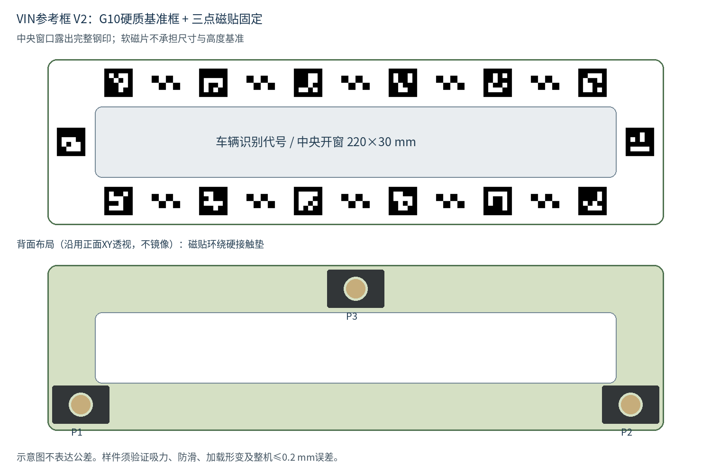
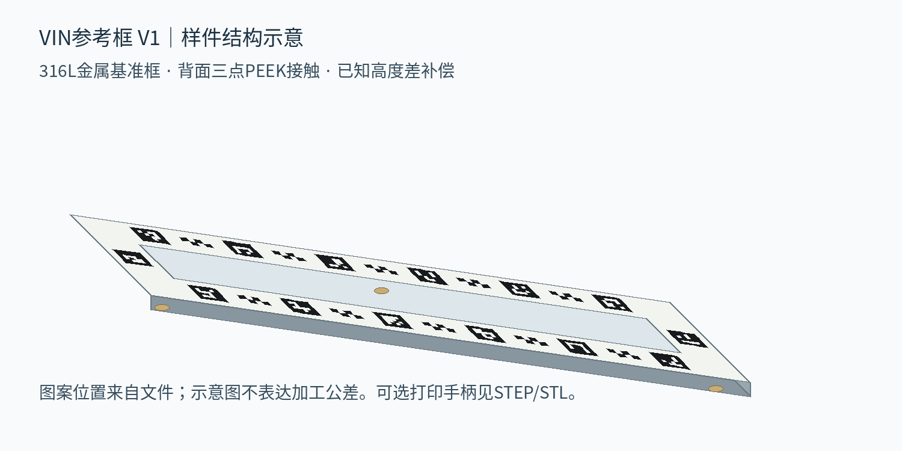

# 车架号等尺寸拍摄：参考框制作包

本仓库保存用于普通手机、专用App和精密参考框的制作资料。当前推荐打样版本为V2磁吸版：用G10玻纤环氧硬质主体替代金属框，并用背面磁贴实现免手扶固定。目标为平面钢印区域约200毫米范围内，校正照片的关键点最大二维位置偏差不超过0.2毫米。

**当前是Rev A样件设计，已检查数字文件，尚未进行实体加工、手机试验和0.2毫米整机验收。设计坐标不能代替成品实测校准。**

## V2磁吸版下载与阅读

- [V2完整制作包ZIP](downloads/VIN_FRAME_V2_MAGNETIC_manufacturing_package.zip)：31项文件，含STEP、DXF、光学母版、4页A3图纸、4页制作说明及实测/验收模板。
- [V2四页A3加工图PDF](manufacturing/VIN_FRAME_V2_MAGNETIC/01_drawings/manufacturing_drawings_A3.pdf)。
- [V2制作与验收说明PDF](manufacturing/VIN_FRAME_V2_MAGNETIC/制作与验收说明.pdf)。
- [V2可直接浏览的制作说明](manufacturing/VIN_FRAME_V2_MAGNETIC/制作与验收说明.md)。
- [V2文件索引](manufacturing/VIN_FRAME_V2_MAGNETIC/README.md)。

V2主体260×70×6毫米，开窗220×30毫米。三片柔性粘结钕铁硼磁贴围绕三片PEEK硬定位垫；磁片固定，硬质主体承担尺寸基准，硬垫定义车身接触面。磁片不接触承重，名义气隙0.10毫米，正式值须实测。主体估算约126克，不含磁贴、垫片和手柄。

**纯软磁片直接印图案不作为≤0.2毫米项目的正式方案。V2也尚未通过实体吸附、防滑、加载形变和整机精度验收。** 适用于经过试验确认可磁吸的平面钢制区域；铝制或吸力不足部位需要其他夹具。图案ID沿用V1，但接触点、材料和名义标记面高度（约7.70毫米加涂层）已改变，必须加载独立V2实测档案，禁止沿用V1高度/热膨胀模型。

V2完整性清单：[SHA256SUMS.txt](manufacturing/VIN_FRAME_V2_MAGNETIC/SHA256SUMS.txt)；数字检查记录：[digital_checks.json](manufacturing/VIN_FRAME_V2_MAGNETIC/digital_checks.json)。

## V1金属版历史资料

- [完整制作包ZIP](downloads/VIN_FRAME_V1_manufacturing_package.zip)：包含28项文件。
- [制作、测量与验收说明PDF](manufacturing/VIN_FRAME_V1/制作与验收说明.pdf)：5页详细流程。
- [四页A3加工图PDF](manufacturing/VIN_FRAME_V1/01_drawings/manufacturing_drawings_A3.pdf)：金属框、接触垫、装配和图案。
- [文件索引](manufacturing/VIN_FRAME_V1/README.md)：各文件的用途及加工注意事项。
- [可直接浏览的制作说明](manufacturing/VIN_FRAME_V1/制作与验收说明.md)。

下载ZIP时打开文件页面后选择 **Raw / Download raw file**；也可在仓库 **Code → Download ZIP** 下载整个仓库。

## 结构与文件

金属框采用CNC加工的316L不锈钢，外形260×70×3毫米，中央开窗220×30毫米。背面三片CNC PEEK接触垫定义接触基准，名义标记面高度约4.30毫米加成像层厚度；正式软件必须使用成品实测值并补偿高度差。

14个ArUco编码和30个棋盘内部角点分布在开窗四周。3D打印仅用于可选手柄，不作为尺寸或接触基准。

| 文件目录 | 内容 |
|---|---|
| `manufacturing/VIN_FRAME_V1/01_drawings/` | 加工图和结构/图案预览 |
| `manufacturing/VIN_FRAME_V1/02_cad/` | 金属框、PEEK垫、装配STEP和分层DXF |
| `manufacturing/VIN_FRAME_V1/03_artwork/` | 1:1图案SVG、填充DXF、PDF和位图 |
| `manufacturing/VIN_FRAME_V1/04_calibration/` | 开发用名义坐标JSON和待填写实测CSV |
| `manufacturing/VIN_FRAME_V1/05_printed_handles/` | 可选手柄STL与STEP |
| `manufacturing/VIN_FRAME_V1/06_sources/` | OpenSCAD、生成脚本及嵌入字体许可 |
| `downloads/` | 原始完整制作包ZIP |

## 加工和验证

先让加工厂评审PDF和STEP，再做1~3件样件。STEP中的螺纹孔为简化底孔，螺纹和深度以PDF为准；粗切只用轮廓DXF，禁止把盲孔图层一起切穿。成像使用独立黑色图案母版，不能使用带尺寸和文字的加工图。

完成涂层、垫片和手柄装配后，测量序列号对应的光学点XYZ、接触基准、高度、平面度和温度，填写实测表。还要验证实际车辆钢印区域的平面度、参考框重复定位、温度影响和相机参数稳定性。

最终用未参与标定的独立测试件验收整套系统，并检查业务系统下载文件。名义JSON、合成图识别结果和CAD有效性均不能证明实物达到0.2毫米精度。

文件完整性清单见[SHA256SUMS.txt](manufacturing/VIN_FRAME_V1/SHA256SUMS.txt)，数字检查记录见[digital_checks.json](manufacturing/VIN_FRAME_V1/digital_checks.json)。

